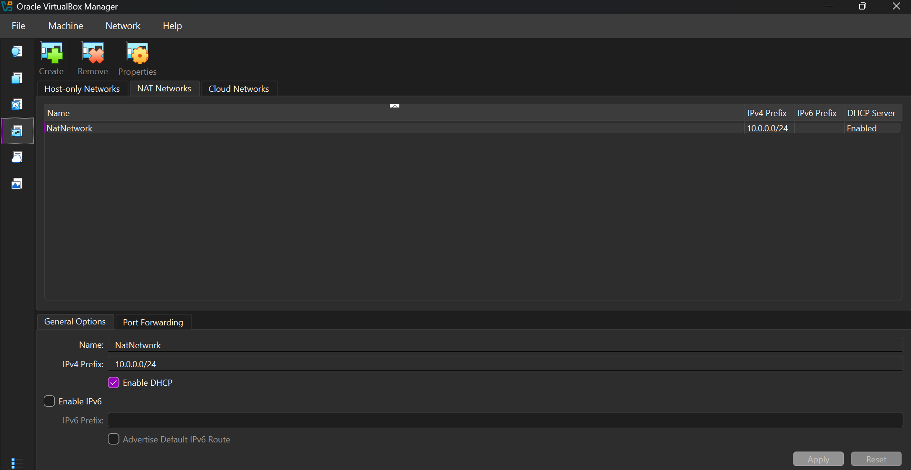
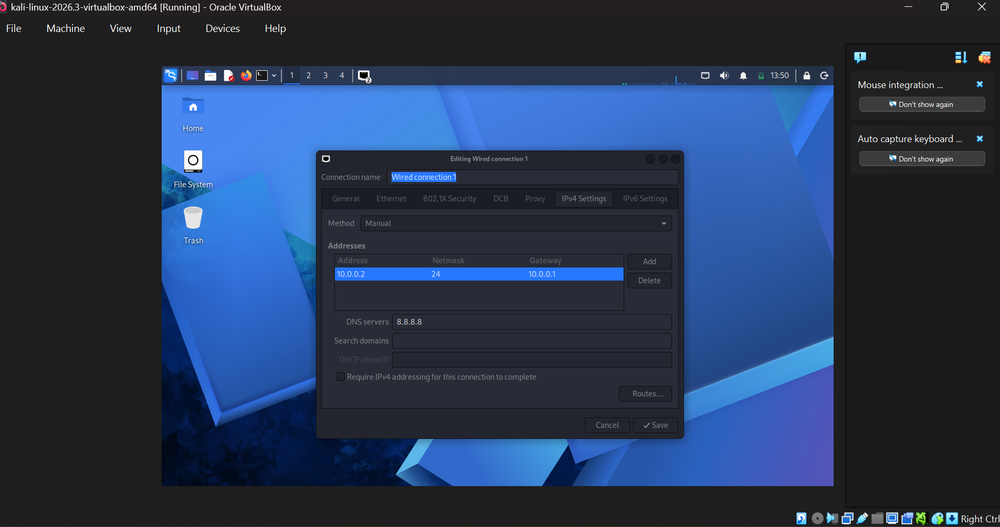

# Networkwalks-B084-week1-Cybersecurity-lab-setup
Cybersecurity-Lab-Setup
## 📑 Table of Contents

- [Project Overview](#-project-overview)
- [Objectives](#-objectives)
- [Purpose of the Lab](#-purpose-of-the-lab)
- [Lab Architecture](#-lab-architecture)
- [Lab Configuration](#-lab-configuration)
- [Setup Procedure](#-setup-procedure)
- [Lab Verification](#-lab-verification)
- [Troubleshooting](#-troubleshooting)
- [What I Learned](#-what-i-learned)
- [Security and Ethical Use](#-security-and-ethical-use)
- [Tools and Resources](#-tools-and-resources)
- [Author](#-author)

##  Project Overview

This project documents how I built a **virtual cybersecurity and penetration-testing laboratory** using **VirtualBox** and **Kali Linux**.

The goal is a controlled, repeatable environment where security tools, network scanning, reconnaissance and vulnerability assessment can be practised safely. The lab runs on a **private NAT Network**, so more virtual machines can be added later and used as targets for authorized testing.

---
##  Objectives

The main objectives of this project are to:

- Install and configure VirtualBox.
- Install/import Kali Linux as a virtual machine.
- Create a private NAT Network for the cybersecurity lab.
- Configure network connectivity for Kali Linux.
- Assign a consistent IP address to the Kali VM.
- Verify network connectivity and DNS resolution.
- Take a clean VM snapshot for recovery.
- Document the complete setup process.
- Prepare the environment for future cybersecurity projects.

##  Purpose of the Lab

The lab provides an isolated space for learning and authorized security testing, such as:

- 🔎 Network reconnaissance
- 📡 Port scanning
- 🛡️ Vulnerability assessment
- 📦 Packet analysis
- 🌐 **Important:** Only use this lab on systems you own or have written permission to test. Never use these tools against unauthorized systems. Web security testing
- 🧰 Security-tool experimentation

> ⚠️ It is important to note that this laboratory must only be used for systems that you own or have proper permission to test. Ensure not to use the lab or its tools to attack unauthorized systems.


## 🗺️ Lab Architecture

```text
                +--------------------------------------+
                |   Host PC (Windows 11, 16 GB RAM)    |
                |                                      |
                |   +------------------------------+   |
                |   |   VirtualBox                 |   |
                |   |                              |   |
                |   |   NAT Network: 10.0.0.0/24   |   |
                |   |   Gateway: 10.0.0.1          |   |
                |   |        |                     |   |
                |   |   +----+------------------+  |   |
                |   |   | Kali Linux 2026.3     |  |   |
                |   |   | 10.0.0.2/24           |  |   |
                |   |   +-----------------------+  |   |
                |   |   (future target VMs here)   |   |
                |   +------------------------------+   |
                +------------------|-------------------+
                                   |
                                Internet
```

---

## ⚙️ Lab Configuration

| 🧩 Component | ⚙️ Configuration |
|---|---|
| 🖥️ Host OS | Windows 11 |
| 🧠 Host RAM | 16 GB |
| ⚡ Processor | Intel Core i7|
| 🧰 Hypervisor | VirtualBox  7.2.22|
| 🐉 Security OS | Kali Linux 2026.3 (pre-built VirtualBox image) |
| 🧠 Kali RAM | 4096 MB |
| ⚙️ Kali CPUs | [2] |
| 🌐 Virtual Network | NAT Network (`NatNetwork`) |
| 📡 Network Address | 10.0.0.0/24 |
| 🐧 Kali IP Address | 10.0.0.2/24 |
| 🚪 Default Gateway | 10.0.0.1 |
| 🌍 DNS Server | 8.8.8.8 |


#  Lab Setup Procedure

## Step 1. Install 7-Zip

I downloaded the pre-built **Kali Linux VirtualBox image** (`kali-linux-2026.3-virtualbox-amd64.7z`) from the official Kali website: https://www.kali.org/get-kali/

## Step 2. Install VirtualBox

I installed **Oracle VirtualBox** as the hypervisor and switched the interface to **Expert Mode** so that all network tools are visible

## Step 3. Create the NAT Network

Configuration:
Network Name: NatNetwork
IPv4 Prefix:  10.0.0.0/24
DHCP:         Enabled
IPv6:         Disabled



A NAT Network was selected because multiple virtual machines connected to the same NAT Network can communicate with one another while also having outbound network connectivity.

This network allow future attacker and target VMs to communicate within the lab.

## Step 4. Import Kali Linux

The Kali Linux virtual machine was downloaded from the official Kali Linux website and imported into VirtualBox.

The VM network adapter was configured as follows:

Adapter 1
Attached to: NAT Network
Network:     NatNetwork
Adapter Type: Intel PRO/1000 MT Desktop
```


```
A shared folder was also configured for transferring required files between the host operating system and the Kali VM.


## Step 5. Configure the Kali Linux Network

The Kali Linux network configuration was checked and configured with a consistent IPv4 address.

Example configuration:

In Kali: **Network icon → Edit Connections → Wired connection 1 → IPv4 Settings**.

| Field | Value |
|---|---|
| Method | Manual |
| Address | 10.0.0.2 |
| Netmask | 24 (255.255.255.0) |
| Gateway | 10.0.0.1 |
| DNS servers | 8.8.8.8 |

A fixed address makes the lab easier to document and to reference in later exercises.



## Step 6. Create a Clean VM Snapshot

With the VM configured and working, I took a snapshot as a recovery point.

| Field | Value |
|---|---|
| Snapshot name | My New Kali-Network setwork |
| Description | Fresh Kali 2026.3, NAT Network 10.0.0.0/24, static IP 10.0.0.2, no tools or updates added yet. |

If a later exercise breaks the VM, I can restore this baseline.


# Lab Verification

| ✅ Test | 🧾 Command | 🎯 Expected Result |
|---|---|---|
| 🌐 Check IP address | `ip a` | `10.0.0.2/24` shown on the network interface |
| 🛣️ Check routing | `ip route` | Default route via `10.0.0.1` |
| 📡 Test gateway | `ping -c 3 10.0.0.1` | Successful replies |
| 🌍 Test internet | `ping -c 3 8.8.8.8` | Successful replies |
| 🔎 Test DNS | `ping -c 3 google.com` | Name resolves and replies arrive |
| 🧰 Verify Nmap | `nmap --version` | Nmap version displayed |
| 🔄 Verify snapshot | Restore snapshot, then run `ip a` | Baseline configuration restored |


### Results

```text
IP Address : 10.0.0.2/24
Gateway    : 10.0.0.1
DNS        : 8.8.8.8
Internet   : reachable
```

#  What I Learned

During the course of this project, I learned how to create and configure a virtual environment for cybersecurity practice.

The main concepts I learned include:

### 1. NAT vs NAT Network
**NAT** lets a VM reach the internet through the host but does not allow direct VM-to-VM communication. A **NAT Network** lets several VMs share one private network while keeping internet access, which suits a multi-machine lab.

### 2. Virtual machine networking
VirtualBox network adapters connect VMs to different network types, and the adapter mode decides who can talk to whom.

### 3. Static IP configuration
I learned how addresses, netmasks, gateways and DNS work together, and how to configure and verify them in Kali.

### 4. File integrity
Checking a SHA-256 hash confirms a download is complete and genuine before it is used.

### 5. Snapshots
A clean snapshot is a known-good recovery point to return to before risky or experimental work.

### 6. Documentation
Recording commands, settings, screenshots, problems and fixes is a key part of professional cybersecurity work.

## 🛡️ Security and Ethical Use

This lab is intended **strictly for education and authorized testing**. Only test systems you own or have explicit permission to assess. The author accepts no responsibility for misuse.

---
#  Tools & Resources

- **7-Zip:** [https://7-zip.org/download.html](https://7-zip.org/download.html)
- **VirtualBox:** [https://virtualbox.org/wiki/Downloads](https://virtualbox.org/wiki/Downloads)
- **Kali Linux:** [https://kali.org/get-kali](https://kali.org/get-kali)

---

# 👤 Author

**Nantumbwe Prossy Kawuma**\
Cybersecurity Professional B084

LinkedIn: 

## Project Information

**Program Name:** Cybersecurity at Networkwalks | **Week:** 01 | **Project:** Cybersecurity & Pentesting Lab Setup | **Repository:** GitHub

## Acknowledgement
This project's structure and documentation structure was inspired by Waqas Karim CCIE
